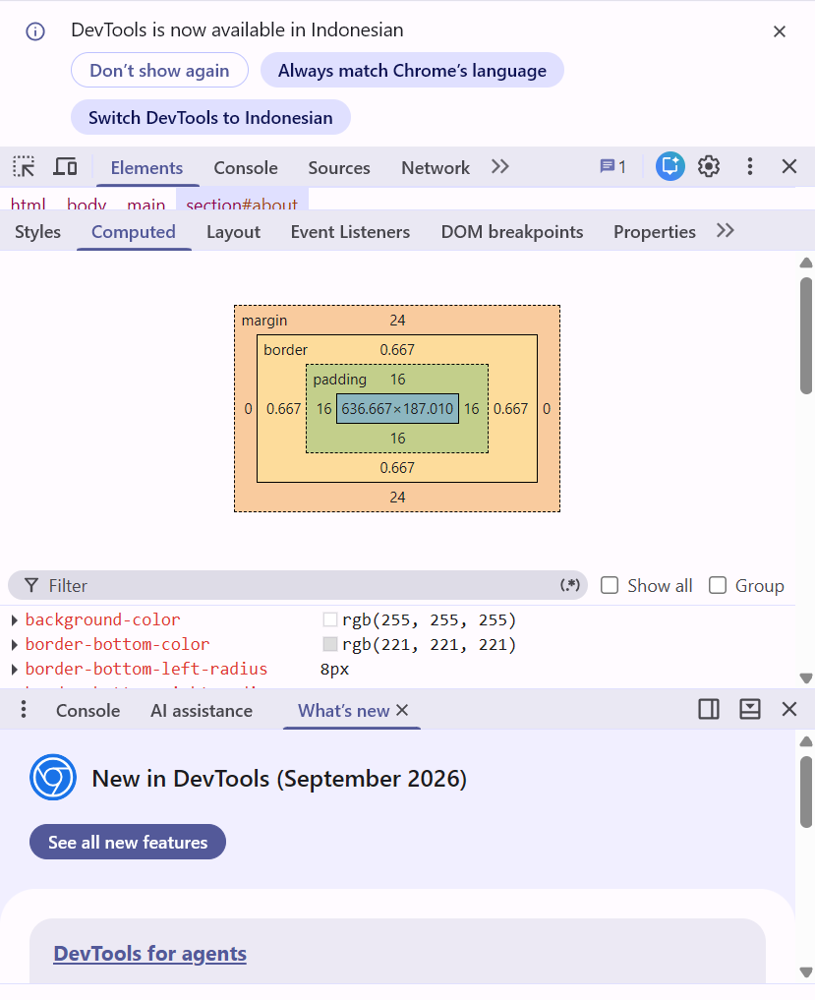
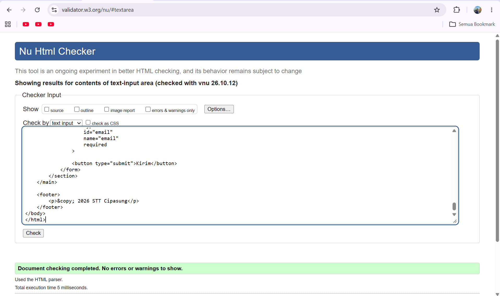

# Jawaban Praktikum: Bangbang Darul Ilmi (10224003)

## Bagian 1: Pemanasan

1. Selector: `nav a.active:hover`. Deklarasi: `color: red;`. Property: `color`. Value: `red`. Pseudo-class: `:hover`.

2. Block: `p`, `li`, `h2`. Inline: `span`, `a`, `strong`.

3. Paragraf yang berwarna hijau adalah A dan B, karena keduanya merupakan elemen `p` di dalam elemen dengan class `box`.

4. Warnanya merah, karena selector `#title` memiliki specificity lebih tinggi daripada selector class `.heading` dan selector elemen `h1`.

5. Tag HTML tidak ditutup secara berurutan. Tag `<strong>` harus ditutup sebelum tag `
`, sehingga penulisannya menjadi `
Hello <strong>world</strong>
`.

## Bagian 3: Prediksi Selector Golf

**P1.**

(a) Weekly hack nights: hijau, karena terkena selector `p` dan `section p`, dengan `section p` memiliki specificity lebih tinggi.

(b) Bring your own laptop: oranye, karena memiliki class `note` yang lebih spesifik daripada `section p`.

(c) © 2026 Student Affairs: biru, karena hanya terkena selector `p`.

**P2.**

Urutan specificity dari tertinggi ke terendah:

1. `#tech p`
2. `.club p`
3. `main section p`
4. `p`

**Setelah diuji (hasil sebenarnya):**

(a) Weekly hack nights: hitam.
(b) Bring your own laptop: hitam dengan latar kuning dan tulisan miring.
(c) © 2026 Student Affairs: hitam.

Hasil tersebut sesuai dengan tampilan yang terlihat di browser.

## Bagian 4: Box model

**Q1 (content-box):**

Lebar kartu yang terlihat adalah 334px.

Perhitungan:
- Width = 300px
- Padding kiri dan kanan = 16px × 2 = 32px
- Border kiri dan kanan = 1px × 2 = 2px
- Total = 300 + 32 + 2 = **334px**

Margin 24px di setiap sisi tidak termasuk lebar kartu itu sendiri.

**Q2 (border-box):**

Jika menggunakan `box-sizing: border-box`, lebar total kartu tetap 300px, termasuk padding dan border. Ukuran area content menjadi 266px.

**Pengecekan DevTools:**

Saya memeriksa elemen `<section id="about">` melalui DevTools → Computed → Box Model.

- Content: 636.667 × 187.010 px
- Padding: 16 px pada semua sisi
- Border: sekitar 0.667 px pada semua sisi
- Margin: 24 px atas dan bawah, 0 px kiri dan kanan

**Screenshot Pengecekan DevTools:**

## Bagian 5: Tabel debug

| # | Baris | Bug | Perbaikan | Cara menemukannya |
|---|---|---|---|---|
| 1 | CSS body | `colour` salah penulisan | Ganti menjadi `color` | Membaca kode |
| 2 | CSS header | Kurang titik koma setelah `background: #dbe7f3` | Tambahkan `;` | Membaca kode |
| 3 | CSS `.Card` | Nama class tidak sesuai dengan HTML `.card` | Ganti `.Card` menjadi `.card` | Membandingkan HTML dan CSS |
| 4 | CSS `#news-list` | Nama ID tidak sesuai dengan HTML `newsList` | Ganti menjadi `#newsList` | Membandingkan HTML dan CSS |
| 5 | CSS `font-size` | `18 px` memiliki spasi yang salah | Ganti menjadi `18px` | Membaca kode |
| 6 | CSS footer | `centre` bukan nilai CSS yang benar | Ganti menjadi `center` | Membaca kode |
| 7 | HTML heading | Tag pembuka `h1` ditutup dengan `h2` | Ganti `</h2>` menjadi `</h1>` | W3C Validator |
| 8 | HTML link About | Tanda kutip pada atribut `href` tidak ditutup dengan benar | Ganti menjadi `href="about.html"` | W3C Validator |
| 9 | HTML gambar | Gambar tidak memiliki atribut `alt` | Tambahkan `alt="Ilustrasi berita kampus"` | W3C Validator dan pemeriksaan aksesibilitas |

## 6. Code Review

### A. Temuan Masalah dan Perbaikan

| No. | Masalah yang Ditemukan | Mengapa Penting? | Perbaikan yang Dilakukan |
|---|---|---|---|
| 1 | Tidak ada `DOCTYPE` dan atribut `lang` | Browser perlu mengetahui standar HTML dan bahasa halaman. | Menambahkan `<!DOCTYPE html>` dan `lang="id"`. |
| 2 | Tidak ada meta charset dan viewport | Karakter bisa salah dibaca dan tampilan kurang responsif di HP. | Menambahkan meta charset dan viewport. |
| 3 | Struktur halaman menggunakan banyak `div` | Struktur konten sulit dipahami dan kurang semantik. | Menggunakan `header`, `nav`, `main`, `section`, dan `footer`. |
| 4 | Judul utama hanya menggunakan teks tebal | Hierarki judul halaman menjadi kurang jelas. | Mengganti judul utama dengan elemen `h1`. |
| 5 | CSS ditulis langsung pada elemen HTML | Kode sulit dirawat ketika tampilan perlu diubah. | Memindahkan pengaturan tampilan ke CSS. |
| 6 | Lebar header ditetapkan 1200px | Halaman bisa melebar dan tidak nyaman di layar kecil. | Menggunakan `max-width` dan tata letak responsif. |
| 7 | Menggunakan `!important` pada tautan | Prioritas CSS menjadi lebih sulit dikelola. | Menghapus `!important` dan mengatur selector dengan benar. |
| 8 | Warna teks konten terlalu pucat | Teks menjadi kurang nyaman dibaca. | Menggunakan warna teks yang lebih gelap dan kontras. |
| 9 | Gambar tidak memiliki atribut `alt` | Pengguna pembaca layar tidak mendapat deskripsi gambar. | Menambahkan atribut `alt` yang sesuai. |
| 10 | Input formulir tidak memiliki label | Pengguna bisa kesulitan mengetahui fungsi setiap kolom. | Menambahkan `label` dengan atribut `for` dan ID input yang sesuai. |
| 11 | Kolom email menggunakan `type="text"` | Format email tidak diperiksa secara otomatis oleh browser. | Mengubahnya menjadi `type="email"`. |
| 12 | Tautan navigasi menggunakan `href="#"` | Tautan tidak menuju bagian halaman yang sesuai. | Menghubungkan tautan dengan ID seperti `#about` dan `#contact`. |
| 13 | Menggunakan ` ` untuk mengatur jarak | Pengaturan tata letak menjadi kurang rapi. | Mengatur jarak menggunakan CSS seperti `margin` dan `padding`. |
| 14 | Tombol hanya menampilkan `alert()` | Data formulir belum benar-benar dikirim ke server. | Menghapus fungsi palsu dan menyiapkan pemrosesan formulir jika diperlukan. |

**Screenshot validasi review-fixed.html:**

### B. Refleksi

**1. Tiga perbaikan terpenting menurut saya:**

Tiga perbaikan terpenting adalah memperbaiki struktur HTML, membuat tampilan responsif, dan meningkatkan aksesibilitas. Struktur HTML yang baik membuat halaman lebih mudah dipahami, tampilan responsif membuat halaman nyaman dibuka di berbagai perangkat, dan aksesibilitas membantu lebih banyak pengguna menggunakan website.

**2. Bagian yang masih ingin saya pelajari:**

Saya masih ingin mempelajari lebih dalam tentang selector CSS, semantic HTML, dan cara menghubungkan formulir dengan database agar data yang diisi pengguna dapat disimpan dengan benar.

## Bagian 7: Exit ticket

1. Anatomi aturan CSS terdiri dari selector dan blok deklarasi. Selector menentukan elemen HTML yang akan diatur, sedangkan deklarasi berisi property dan value yang menentukan tampilannya.

2. Saya masih ingin memahami specificity CSS dan cara menentukan selector mana yang akan diterapkan ketika beberapa aturan mengatur elemen yang sama.

3. Saya sekarang bisa membuat struktur HTML menggunakan elemen semantik, menghubungkan file CSS ke HTML, dan mengatur tampilan halaman menggunakan selector CSS.